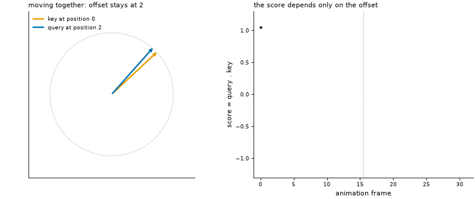
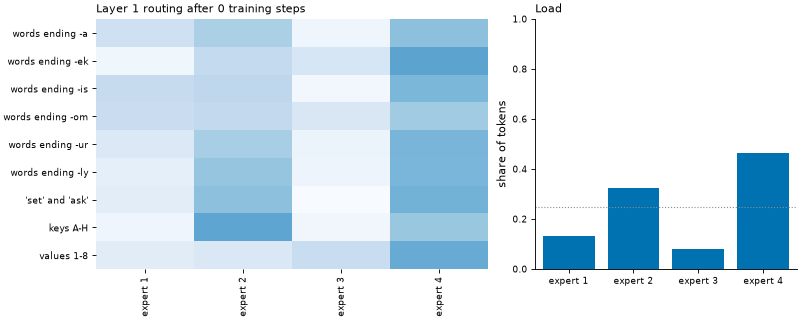
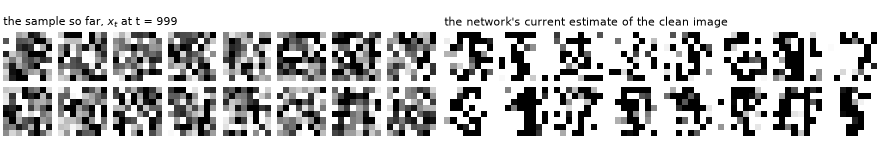
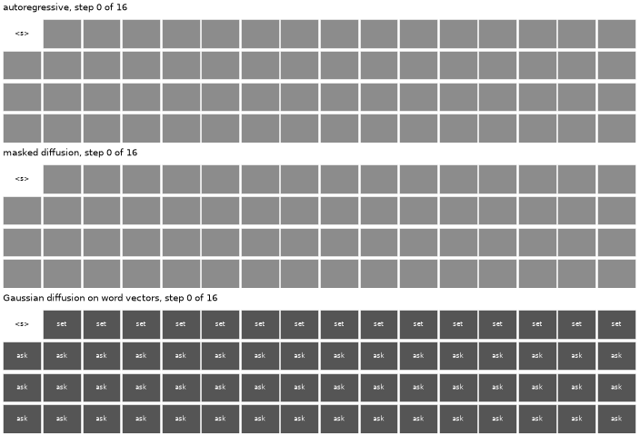

# Pre-Training, From First Principles: n-grams → Transformers → Diffusion → Diffusion Transformers

A progressive, hands-on series on **pre-training**: how we got from counting word pairs to the base models that
today's systems start from. It is the prequel to the
[post-training pathway](https://github.com/LRCole3/post-training-pathway), which begins where this one ends.

Three rules shape every notebook:

* **Each method appears because the previous one fails at something measurable.** A shared scorecard
  (`results/scorecard.csv`) makes the failures visible.
* **Design choices are explained, not just used.** Every notebook has a *Design choices: what changed since* section:
  the original choice, what the field moved to (rotary position embeddings, mixture of experts, flow matching, ...),
  why, and an ablation where a laptop can show the effect. Where it cannot, the notebook says so.
* **Visual first, interactive where possible.** Diagrams, heat maps and animations for each concept, plus
  slider-driven explorers.

## Why toy-sized models?

Real pre-training needs data centres. This series instead builds two small worlds with a **ground truth**:

* **Language (01–05, 10):** a synthetic language with a known generator (`prelib/world.py`). Words have classes,
  documents have a hidden topic and a hidden style, and a document can bind a key to a value and ask for it later.
  Because we own the generator, the **best achievable loss is computed exactly**, long-range recall can be tested at
  any distance, and the hidden style gives a downstream task for measuring what pre-training learned.
* **Images (06–10):** scikit-learn's 8×8 handwritten digits (no download), scored by a frozen "judge" classifier
  that plays the role of FID's Inception network.

The trade-off: these notebooks show **mechanisms and failure modes**, not the papers' headline numbers. Several
modern design choices pay off only at scales a laptop cannot reach. Results are reported as measured.

## Learning path

| # | Notebook | Methods | Design choices covered | Limitation that motivates the next step | Status |
|---|---|---|---|---|---|
| 01 | [Counting and embeddings](01_ngrams_and_embeddings.ipynb) | n-grams, smoothing, window MLP, skip-gram | Kneser-Ney vs add-k; negative sampling; subword vectors | Fixed window; one vector per word | available |
| 02 | [Recurrent models, attention, contextual pretraining](02_rnns_attention_elmo.ipynb) | RNN, LSTM, GRU, attention, ELMo-style transfer | Gating; gradient clipping; additive vs dot-product attention | Memory fades with distance; no parallel training | available |
| 03 | [The transformer, built from scratch](03_transformer_from_scratch.ipynb) | Self-attention, the 2017 block, then today's block | Pre-LN and RMSNorm; RoPE and ALiBi; SwiGLU; grouped-query attention; mixture of experts | Needs an objective and a transfer recipe | available |
| 04 | [Pretraining objectives and transfer](04_objectives_and_transfer.ipynb) | Causal, masked, span corruption; probing and fine-tuning | Masking rate; dynamic and span masking; encoder vs decoder | No objective wins everything | available |
| 05 | [Making pretraining scale](05_scaling_pretraining.ipynb) | Tokenisers, optimiser recipe, scaling laws, in-context recall | BPE and vocabulary size; AdamW; warmup and cosine decay; weight tying | Discrete tokens only | available |
| 06 | [Generative pretraining for images before diffusion](06_vae_gan_autoregressive.ipynb) | Autoencoder, VAE, GAN, WGAN-GP, pixel autoregression | KL weight and annealing; GAN losses and penalties | Blur, mode collapse, slow sampling | available |
| 07 | [The diffusion training design space](07_diffusion_design_space.ipynb) | DDPM and its training choices | Schedules; prediction targets; loss weighting; preconditioning; EMA | Pixel space, MLP backbone, no text | available |
| 08 | [Pretrained parts: encoders, CLIP, latent diffusion](08_representations_and_latent_diffusion.ipynb) | MAE, contrastive learning, CLIP-style model, latent diffusion | Mask ratio; softmax vs sigmoid contrastive loss; KL vs VQ latents | The backbone still does not scale | available |
| 09 | [Pretraining diffusion transformers](09_pretraining_diffusion_transformers.ipynb) | DiT, flow matching, scaling, training accelerators | Conditioning route; position scheme; timestep sampling; masking; REPA | Base models still need post-training | available |
| 10 | [Capstone: one architecture, three objectives](10_capstone_unified_pretraining.ipynb) | Autoregressive, masked diffusion and Gaussian diffusion on one backbone, for text and images | Objective per kind of data; positions for models that see both sides; unmasking order; image tokens; the memorisation check | The post-training series starts here | available |

## What it looks like

Every notebook has animations and slider-driven explorers. Four of the seventeen animations:

| | |
|---|---|
|  |  |
| Rotary positions (notebook 03) | Mixture-of-experts routing (notebook 03) |
|  |  |
| Diffusion sampling (notebook 07) | Three ways to write a document (notebook 10) |

## Runtimes

Measured on a laptop CPU with four threads, one full execution each. Run to run they vary by about 10%.

| Notebook | 01 | 02 | 03 | 04 | 05 | 06 | 07 | 08 | 09 | 10 |
|---|---|---|---|---|---|---|---|---|---|---|
| Minutes | 2 | 7 | 24 | 24 | 20 | 5 | 8 | 13 | 28 | 27 to 30 |

The whole series takes about two and a half hours. Notebooks 05, 07, 08 and 09 save base-model checkpoints
(`checkpoints/`, not committed): the kind of model that the post-training pathway starts from.

## Where each design choice is tested

| Design choice | Notebook |
|---|---|
| Smoothing; negative sampling; subword vectors | 01 |
| Gating (LSTM, GRU); gradient clipping; additive and dot-product attention | 02 |
| Pre-norm and RMSNorm; sinusoidal, relative, ALiBi and **rotary positions (RoPE)**; SwiGLU; grouped-query attention; **mixture of experts** | 03 |
| Masking rate; dynamic and span masking; replaced-token detection; positions in an encoder; encoder against decoder | 04 |
| Sub-word tokenisers (BPE); warm-up and cosine decay; AdamW; weight tying; context length; model size against data | 05 |
| Reparameterisation; KL weight and annealing; Wasserstein loss and gradient penalty; softmax pixel outputs | 06 |
| Samplers; noise schedules; prediction target ($\epsilon$, $x_0$, $v$); loss weighting; preconditioning; EMA; classifier-free guidance | 07 |
| MAE mask ratio; contrastive views, temperature and batch size; softmax against sigmoid text-image loss; KL against quantised codes; frozen text encoders | 08 |
| Patch size; conditioning route (adaLN-Zero, cross-attention, in-context); position scheme; flow matching; timestep sampling; masked training; representation alignment | 09 |
| The objective itself, for text and for images; positions for models that see both sides; unmasking order; image tokenizers; guidance for token models | 10 |

## Results that did not follow the textbook

The notebooks report what was measured at this scale. Some of it disagrees with the published picture, and each
notebook says so where it happens.

* **02 and 03.** An LSTM with attention (gap 0.049) is close to the transformer (0.046) on this language. SwiGLU and
  RMSNorm made no measurable difference, and a mixture of experts gave no gain at this size.
* **05.** At equal training steps a model with 415,000 parameters was no better than one with 109,000.
* **07.** Predicting the clean image beat predicting the noise or $v$ (FD 8.5 against 25.2 and 30.6), and
  preconditioning hurt (25.8 against 7.7).
* **08.** Pretrained vision features were level with raw pixels once 20 labels per digit were available. The
  advantage of large batches in the text-image model was the extra data.
* **09.** Larger patches were better (FD 6.3, 8.1, 13.4 for 4, 16 and 64 tokens). Flow matching did not beat
  clean-image diffusion. The gain from representation alignment disappeared with sinusoidal positions.
* **10.** The autoregressive image model reached the best FD of the series by copying its training set (87% of
  samples). Masked and Gaussian diffusion language models trained poorly with sinusoidal positions and much better with rotary positions (RoPE).

## Limits

* **Scale.** Models have about 9,000 to 1,100,000 parameters and train in seconds to minutes. Conclusions are about
  mechanisms at this scale.
* **Seeds.** Most comparisons are single runs. Where a notebook repeats a baseline with more seeds it says so, and
  effects inside the seed range are reported as no effect.
* **Not tested.** The notebooks name the ablations they leave out. Among them: mixture of experts at equal total
  parameters, BERT's 80/10/10 replacement rule and next-sentence prediction, unigram tokenisers, weight clipping,
  rotary positions at other image resolutions, and a relative position bias on the shared backbone of notebook 10.
* **Simplified variants.** Masked training in notebook 09 and Gaussian diffusion on word vectors in notebook 10 are
  simplified versions of the published methods; the notebooks describe the differences.
* **Environment.** The notebooks were executed in order on one machine (macOS, Python 3.12, CPU). They were not
  re-run from a fresh clone, and the Colab path is untested.

## Getting started

```bash
git clone https://github.com/LRCole3/pre-training-pathway.git
cd pre-training-pathway
pip install -r requirements.txt
jupyter lab
```

Run the notebooks **in order, from the repository root**. No GPU is needed.

**Interactive parts.** The sliders need a running notebook (JupyterLab, VS Code or Colab). GitHub's viewer shows a
static preview of each explorer at its default settings, and the animations (GIFs in `figures/`) play everywhere.
Each notebook has an "Open in Colab" badge; that path has not been tested by the author.

## Repository layout

```
├── 01_ … 10_*.ipynb
├── prelib/
│   ├── world.py        # the synthetic language, its oracle loss floor, recall tests and the probe task
│   ├── classic.py      # 01: n-grams, window model, skip-gram
│   ├── recurrent.py    # 02: RNN, LSTM, GRU, attention
│   ├── transformer.py  # 03-05: a transformer whose design choices are switches (RoPE, RMSNorm, SwiGLU, GQA, MoE)
│   ├── objectives.py   # 04: causal, masked, span-corruption and replaced-token objectives; probes
│   ├── scale.py        # 05: tokenisers, optimiser recipe, size and data
│   ├── generative.py   # 06: autoencoder, VAE, GAN, WGAN-GP, pixel autoregression
│   ├── diffusion.py    # 07: diffusion with every training choice as an argument
│   ├── vision.py       # 08: ViT, masked autoencoder, contrastive learning, text-image model
│   ├── latent.py       # 08: autoencoders and latent diffusion
│   ├── dit.py          # 09: diffusion transformer, flow matching, masked training, representation alignment
│   ├── unified.py      # 10: one backbone, three objectives, samplers
│   ├── viz.py          # figure style, diagrams, heat maps, token strips, GIF animations, explore() sliders
│   ├── images.py       # 8x8 digits, judge classifier, sample grids
│   └── metrics.py      # shared scorecard (language and image metrics)
├── figures/          # animations produced by the notebooks
├── research_papers/  # every cited paper, by notebook, with verified arXiv / DOI links
├── results/           # scorecard.csv (every model) and series_scorecard.csv (best per notebook)
└── requirements.txt
```

Each notebook follows the same format: an overview that places it in the series, learning objectives, worked
sections with figures, a design-choices section, **Challenge Problems** with a solution cell immediately below,
a final summary and references with links.

## Credit

The teaching format follows the
[Protein_Design `ppi_deep_learning` series](https://github.com/LRCole3/Protein_Design/tree/main/ppi_deep_learning).
`prelib/images.py` and `prelib/metrics.py` are reused from the post-training pathway. The methods belong to the
authors cited in each notebook; see [`research_papers/README.md`](research_papers/README.md).
